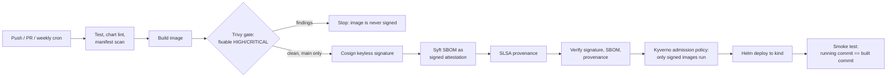

# Helmsman

[](https://github.com/makrischaralampos/helmsman/actions/workflows/ci.yml)
[](https://github.com/makrischaralampos/helmsman/actions/workflows/codeql.yml)

A secure CI/CD pipeline that takes a commit to a running Kubernetes deployment, and refuses to
deploy anything it cannot prove it built, scanned and signed itself.

On every commit it builds, tests and scans the image for vulnerabilities, generates an SBOM,
signs the image keylessly, attaches signed attestations, and then deploys to a fresh
Kubernetes cluster **only after re-verifying everything**, finishing with a smoke test that
proves the running pod is the exact commit that was built.

**Stack:** GitHub Actions, Docker (BuildKit), Helm, kind, Trivy, Syft, Cosign (Sigstore),
GitHub artifact attestations (SLSA provenance).

The service being delivered is deliberately tiny (a Java 21 HTTP service on a distroless image).
The pipeline is the product, and it is application-agnostic.

Screenshots of a real run are in [docs/evidence.md](docs/evidence.md).

## Pipeline



| Stage      | What happens                                                                                                                       | Tooling                     |
| ---------- | ---------------------------------------------------------------------------------------------------------------------------------- | --------------------------- |
| Test       | Unit tests, Helm lint, manifest misconfiguration scan                                                                              | Maven, JUnit 5, Helm, Trivy |
| Build      | Multi-stage build, fresh base pull, digest-pinned base images                                                                      | Docker BuildKit             |
| Scan       | Fails on fixable HIGH/CRITICAL; SARIF uploaded to the Security tab                                                                 | Trivy                       |
| Sign       | Keyless signature by digest, identity bound to this workflow on `main`                                                             | Cosign, Sigstore            |
| SBOM       | SPDX SBOM generated and attached as a signed attestation                                                                           | Syft, Cosign                |
| Provenance | SLSA build provenance, stored alongside the image                                                                                  | GitHub attestations         |
| Verify     | Signature, SBOM and provenance re-checked before deploy, plus a negative control                                                   | Cosign, `gh attestation`    |
| Deploy     | Kyverno admits only images signed by this workflow, then Helm deploys by immutable digest into a restricted Pod Security namespace | Kyverno, Helm, kind         |
| Smoke test | Health, version/commit match, 404 behaviour, replica readiness                                                                     | `scripts/smoke-test.sh`     |

Pull requests run everything up to the scan gate and publish nothing. Only `main` pushes
(and the weekly rebuild) publish, sign and deploy.

## Security controls

**Supply chain**

- Image is scanned before it is signed. An image that fails the gate is never signed, so the
  deploy job cannot accept it.
- Keyless signing: no long-lived signing key exists to steal. The certificate identity is
  `ci.yml@refs/heads/main`, so a fork, a feature branch or a different workflow cannot produce
  a valid signature.
- The deploy job verifies independently of the build job, and includes a negative control that
  proves a foreign image is rejected.
- Deploys by digest, never by mutable tag.
- All GitHub Actions are pinned to commit SHAs; Dependabot updates actions, base images and
  Maven dependencies, and every update must pass the same scan gate.
- Weekly scheduled rebuild so base-image fixes are picked up, rescanned and re-signed even
  when no code changed.
- CodeQL on the Java code and on the workflows themselves; secret scanning with push protection.

**Runtime**

- Distroless, non-root image; read-only root filesystem; all capabilities dropped; seccomp
  `RuntimeDefault`; no service account token mounted.
- Namespace enforces the `restricted` Pod Security Standard. The cluster rejects insecure pods.
- PodDisruptionBudget, resource requests and limits, rolling updates with zero unavailable.
- NetworkPolicy: ingress on the app port only, no egress.
- Admission control: a Kyverno `ImageValidatingPolicy` rejects any pod in the namespace whose image
  is not signed by `ci.yml` on `main`, enforced by the cluster itself. The pipeline asserts this on
  every run by trying to start an unsigned image and requiring the rejection.

**Workflow hygiene**

- `permissions: {}` at the top; each job declares only what it needs.
- Default workflow token is read-only; branch protection requires the checks and linear history.

## Verify it yourself

You do not have to trust the pipeline's output. Verification needs only the repository name:

```bash
./scripts/verify-image.sh sha-<short-commit>
```

It resolves the tag to a digest and checks, as an outside consumer would:

1. the Cosign signature, pinned to this repository's workflow identity;
2. the SBOM attestation;
3. the SLSA build provenance.

Or run Cosign directly:

```bash
cosign verify ghcr.io/makrischaralampos/helmsman@sha256:<digest> \
  --certificate-identity https://github.com/makrischaralampos/helmsman/.github/workflows/ci.yml@refs/heads/main \
  --certificate-oidc-issuer https://token.actions.githubusercontent.com
```

A signature from any other identity, including a different branch of this repo, fails.

## Run the whole pipeline locally

Prerequisites: Docker, kind, kubectl, Helm, Trivy, Maven, JDK 21.

```bash
make up      # test, lint, build, scan, create cluster, deploy, smoke test
make clean   # delete the cluster
make help    # list targets
```

`make up` runs the same stages as CI, so failures can be debugged in seconds instead of
waiting on a runner.

## Repository layout

```
app/                     sample service, Dockerfile, tests
charts/helmsman/         Helm chart (hardened Deployment, Service, PDB, NetworkPolicy)
deploy/                  kind cluster config, namespace with Pod Security labels
scripts/                 smoke test, consumer-side image verification
.github/workflows/       ci.yml (pipeline), codeql.yml
.github/dependabot.yml   automated updates for actions, base images, Maven
.trivyignore.config      documented misconfiguration exceptions (each with a reason)
```

## Design decisions and trade-offs

- **Gate before signing, not before pushing.** The image is pushed by digest so it can be
  scanned and attested by reference, but it stays unsigned until the scan passes. Verification
  at deploy time is what makes an unsigned image unusable.
- **Keyless over key-based signing.** Nothing to rotate or leak. The trade-off is reliance on
  the public Sigstore infrastructure and the GitHub OIDC issuer.
- **Distroless base.** Smaller attack surface, but no shell for debugging, and fixes depend on
  upstream rebuild cadence. The weekly rebuild and Dependabot digest bumps address staleness.
- **Why Actions are pinned by SHA.** In March 2026 the version tags of `trivy-action` were
  force-pushed to malicious commits in a supply-chain attack. Pinning by commit SHA is the
  defence, and Dependabot keeps the pins current.
- **Documented exceptions only.** Two Trivy misconfiguration findings are suppressed in
  `.trivyignore.config`, each with a written reason. The vulnerability gate has no exceptions.

## Limitations and next steps

- Deploys target an ephemeral kind cluster in CI, which demonstrates the mechanism rather than
  a long-lived environment.
- Admission policy is enforced in an ephemeral cluster and scoped to one namespace; a real
  environment would apply it cluster-wide with an exception list for system namespaces.
- The Kyverno chart is pinned by version but not by digest.
- Single architecture (linux/amd64).
- OpenSSF Scorecard and SLSA level assessment are not yet published.

## License

MIT
