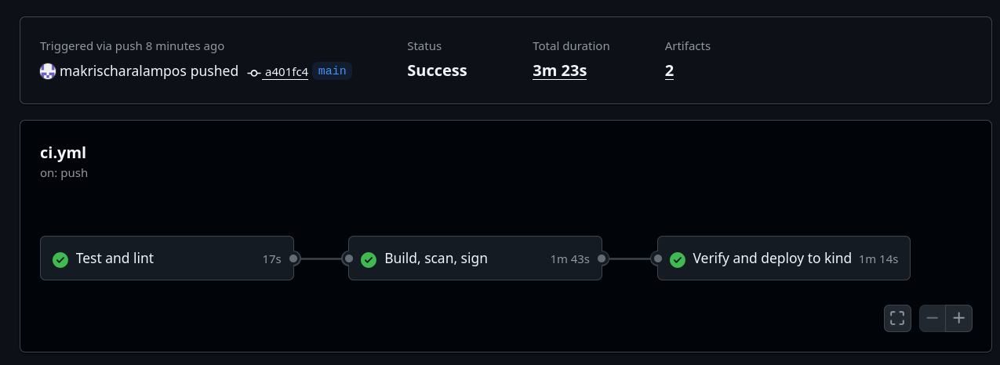
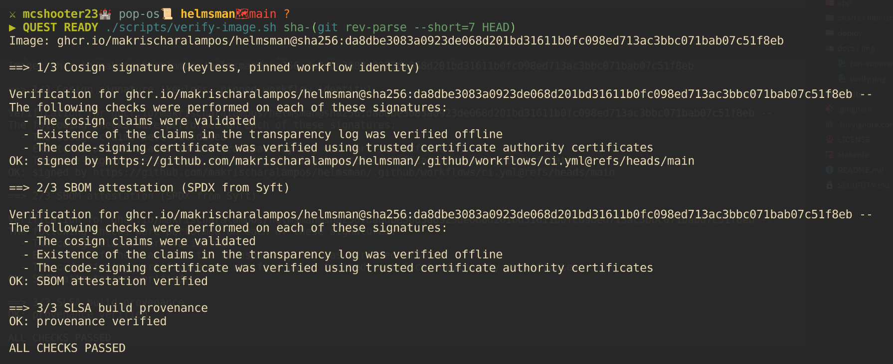
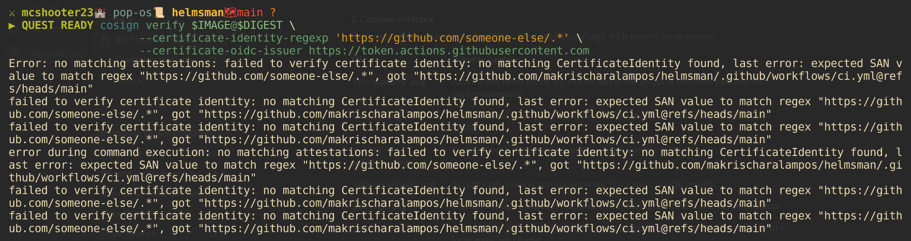
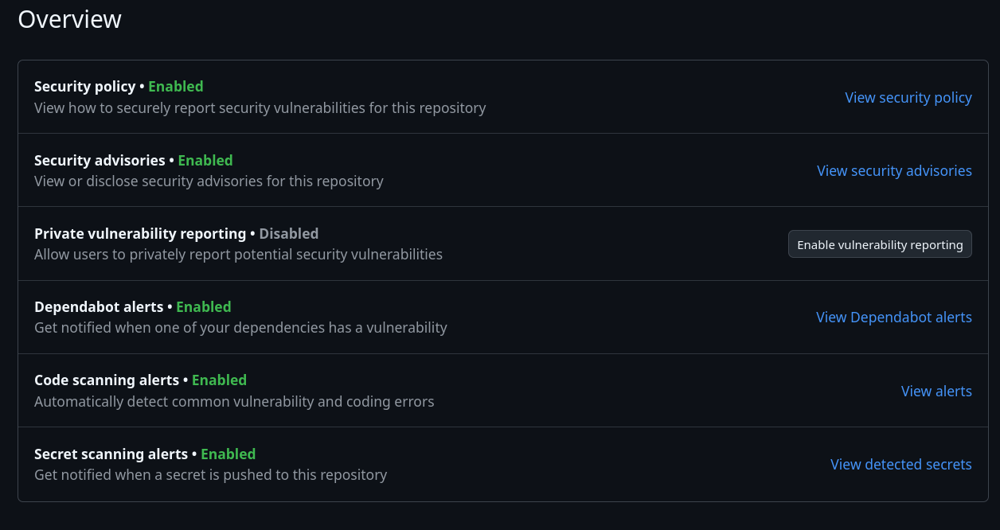
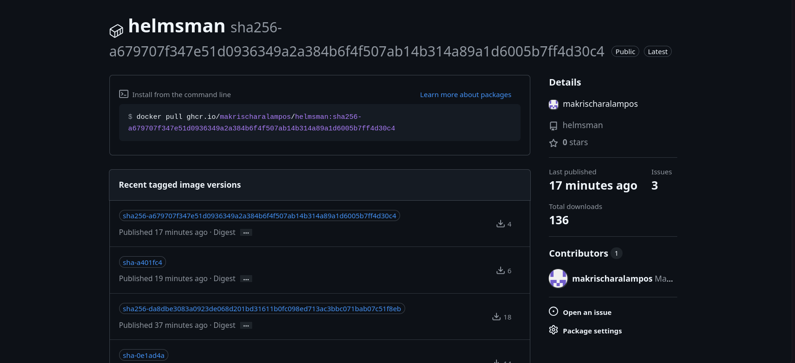
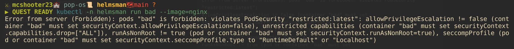
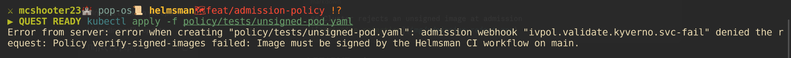

# Evidence

## Green pipeline run

## Consumer-side verification passes

## Verification rejects the wrong identity

## Findings surfaced in the Security tab

## Signed artifacts on the registry

## Cluster rejects an insecure pod

## Cluster rejects an unsigned image at admission

